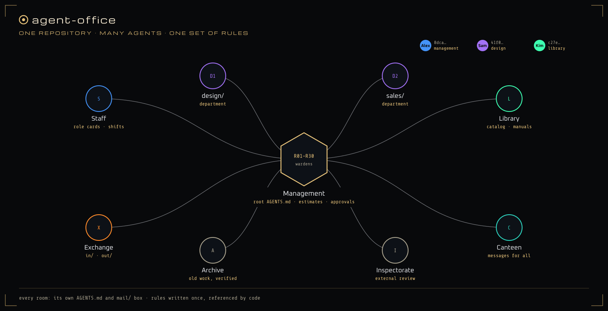
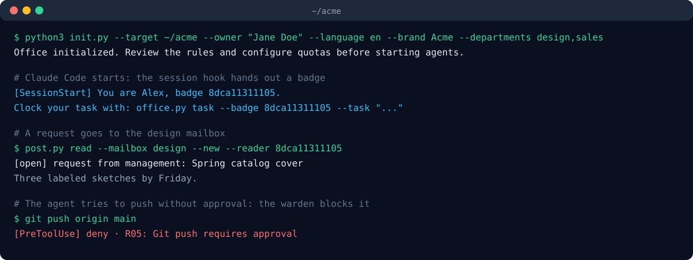
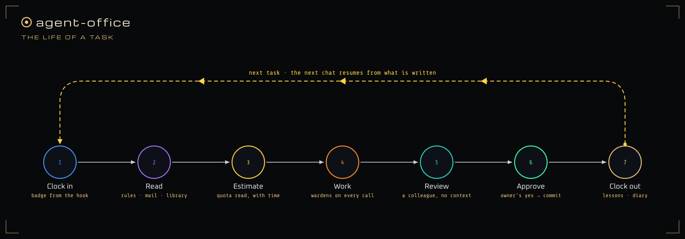

# agent-office

**Run a team of Claude Code agents in one repository like a small company.**

[](LICENSE)




agent-office is a Claude Code skill and a folder template. It turns a repository into an office: agents get a badge, rooms, layered rule files, mailboxes and a shared library. Small Python tools wired to Claude Code hooks enforce the important rules, so they do not depend on what a model happens to remember.

## Why

With one agent, a good prompt is enough. With several agents working in the same repository, over many chats, the same problems keep coming back:

- rules repeated in five places that drift apart;
- nobody knows who is working on what, or who left a job half done;
- a new chat starts from zero because nothing was written down;
- the usage quota runs out in the middle of a long job;
- an agent pushes, kills a process or edits a file it should not touch.

agent-office answers each of these with a file, a habit or a script.

## What you get

| | |
|---|---|
| **Rooms** | A folder per room: management, departments, staff, library, canteen, exchange, archive, inspectorate. Each room can have its own `AGENTS.md` and its own `mail/` box. |
| **Layered rules** | 30 generic rules (R01–R30) written once in the root `AGENTS.md`. Lower levels add their own rules and point to the root ones by code, never copy them. |
| **Badge and shifts** | The session-start hook gives every agent a name and a badge. Agents clock their task, rest or leave; open shifts are visible. |
| **Mailboxes** | Requests, replies and notes go to the recipient's room. `post.py read --mailbox <room> --new --reader <badge>` shows everything since the last read. |
| **Library** | A catalog of what the office already knows, searched before anyone looks elsewhere. |
| **Estimates and quotas** | An estimate before every task, quota readings with their time, thresholds on the session window and a brake on new agents. |
| **Wardens** | 13 checks wired to hooks: 6 block (push, wide kill, protected ports and folders, secrets, new agents above the quota threshold) and 7 warn. |
| **Approvals** | An explicit yes from the owner becomes a commit `Approved: <what>`; binaries are recorded with a SHA-256. |
| **Lessons and diary** | Every correction of the owner is written at once, so the next chat does not repeat the mistake. |
| **Away mode (optional)** | A systemd user timer that wakes an agent only for messages the owner flagged in advance. |

## Requirements

**Needed**

- **Python 3.9 or newer** (written for 3.9, tested on 3.14). The tools use the standard library only: there is nothing to install with pip.
- **[Claude Code](https://docs.anthropic.com/en/docs/claude-code).** The hooks in `.claude/settings.json` run the badge, the wardens and the mail check.

**Recommended**

- **Git.** Needed for commit-by-path habits, approvals as commits and the push warden.

**Optional**

- **Linux.** `cpu_cap.py` reads `/proc` to keep long jobs under a CPU limit.
- **`systemd --user`.** Only for the away-mode timer (`watchdog.py`).
- **The `claude` command on the PATH.** Only for the away-mode timer and for the cheap AI warden, which is off by default.
- **A quota source.** `tools/adapters/quota_from_ccusage.py` imports a small normalized JSON file (format in the script). You can fill it from a tool such as [ccusage](https://github.com/ryoppippi/ccusage); the conversion is yours to write. Without readings the office still works and credit checks only warn.

## Quick start

1. Install the skill:

   ```bash
   git clone https://github.com/Aron-Magg/LLMCompany ~/.claude/skills/agent-office
   ```

2. Create an office in an empty folder (or ask Claude Code to "set up an agent office in this folder"):

   ```bash
   python3 ~/.claude/skills/agent-office/scripts/init.py \
     --target ~/acme --owner "Jane Doe" --language en \
     --brand "Acme" --departments design,sales --teams claude,codex
   ```

   `--target`, `--owner` and `--language` are required. A non-empty target is refused unless you add `--force`: then only missing files are created and existing registry files, `AGENTS.md`, `LESSONS.md` and `DIARY.md` are kept.

3. Open Claude Code in the new folder. The first agent receives its badge, reads the root `AGENTS.md`, clocks its task and checks its mailbox.



*Real output from a fresh demo office (paths shortened).*

## How it works



1. **Clock in.** The session-start hook gives a name and a badge.
2. **Read.** The agent reads every `AGENTS.md` from the root down to its room, its mail and the library catalog.
3. **Estimate.** Before a task: what, which team, the quota read with its time, the expected cost and a margin.
4. **Work.** Wardens look at every tool call and at every reply.
5. **Review.** A colleague who did not do the work checks it without context.
6. **Approve.** An explicit yes from the owner becomes a commit.
7. **Clock out.** Lessons and diary are written, so the next chat resumes from the files, not from memory.

### Rules and wardens

Each rule has four parts: the rule, its exceptions, how it is checked (a warden, a tool or "judgment") and a typical mistake. A temporary exception is recorded with `wardens.py exception`, with a reason, the owner's words and an expiry; a permanent exception becomes a change of the rule. Rules broken twice become a warden.

A broken warden never blocks: if a check crashes or reads stale data, it only warns. Blocking is kept for explicit, tested rules. See [`references/rules.md`](references/rules.md) and [`references/wardens.md`](references/wardens.md).

### Credit and quotas

Every sentence about credit gives the reading with its time. On the session window the thresholds are 65% (warning), 80% (no new agent without the owner's go) and 90% (only wrap-up), in a trial phase before moving to 70/85/95. The warden enforces the 80% brake on launching new agents; the other thresholds are guidance shown with `wardens.py thresholds`. A stale or missing reading gives warnings only; reading, writing and the terminal always stay allowed. `shifts.py` records estimates and actual usage, so each estimate can be compared with what the task really cost.

## Project layout

```
SKILL.md            the skill read by Claude Code
references/         architecture, processes, rules, wardens, organization, watchdog, lessons
template/           the office skeleton copied by init.py (rooms, AGENTS.md files, hooks)
scripts/init.py     creates a new office
tools/              office.py, post.py, shifts.py, wardens.py, library.py, cpu_cap.py, watchdog.py
tools/tests/        27 tests, standard library unittest
docs/images/        the pictures of this page
```

Run the tests with:

```bash
python3 -m unittest discover -s tools/tests
```

## FAQ

**Is this an agent framework?** No. There is no orchestrator and no API calls. It is a set of files, habits and small scripts for agents you already run in Claude Code.

**Does it work with other agents?** The files and the tools are plain Markdown and Python. Agents without hooks can clock in and move by hand with `office.py in` and `office.py move`; the wardens need Claude Code hooks.

**Does it work on macOS or Windows?** The core tools are plain Python. `cpu_cap.py` needs Linux, and the away-mode timer needs `systemd --user`.

**Will it spend tokens on its own?** No. The tools are not models. Only the optional AI warden and the optional away-mode timer call `claude`, and both are off until you turn them on.

## Author and license

Created by Aron Maggisano. Released under the MIT License (see [`LICENSE`](LICENSE)).
